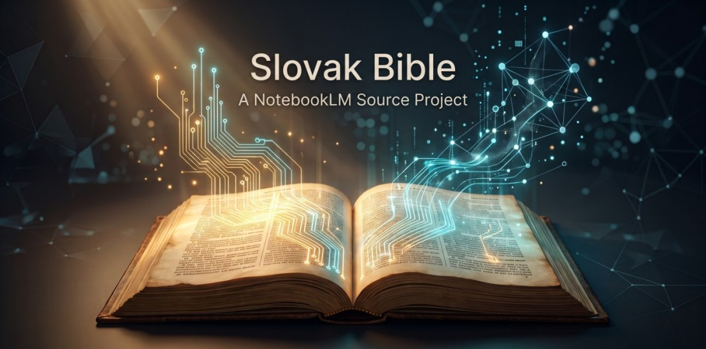

# Bible AI Pipeline (Slovenská Biblia pre AI modely)



Automatizovaná dátová pipeline na predspracovanie a obohatenie textu Biblie (Slovenský ekumenický / katolícky preklad), krížových odkazov (OpenBible.info cross-references), geografických GPS dát a lokálnych MP3 audio nahrávok.

Výsledné dáta sú pripravené pre:

1. **Google NotebookLM** (štruktúrovaný Markdown rozdelený do súborov v limite 50 zdrojov).
2. **Antigravity / SQL agentov** (SQLite databáza s FTS5 full-textovým indexom).
3. **Vektorové databázy / RAG** (JSONL formát pripravený pre ChromaDB, Pinecone, Qdrant).

---

## ⚖️ Disclaimer & Autorské práva (Copyright)

Tento projekt je **bezplatný open-source** (vydaný pod licenciou MIT) vytvorený výhradne na výskumné, študijné, vzdelávacie a nekomerčné účely. Neobsahuje žiadne priame speňaženie a kód je verejne prístupný pre komunitu.

Pri používaní projektu a jeho dát, prosím, berte na vedomie nasledovné:

### 1. Autorské práva na texty a preklady

* **Slovenský ekumenický preklad (SEB):** Texty sú chránené autorským zákonom a patria ich príslušným držiteľom práv (Slovenská biblická spoločnosť). Surový XML súbor `SlovakianSEBBible.xml` ani MP3 nahrávky **nie sú priamou súčasťou tohto git repozitára** z dôvodu ochrany autorských práv. Pipeline je navrhnutá tak, aby si oprávnený používateľ stiahol/pripravil tieto súbory do svojho lokálneho prostredia sám (napr. cez `task download` z voľne dostupných internetových zdrojov alebo vlastným importom).
* **OCP Apokryfy / Pseudepigrafy (napr. 1En, Jubi):** Sú prekladané z historických, verejne dostupných (public domain) anglických a kritických predlôh (Online Critical Pseudepigrapha). Slovenský preklad týchto apokryfov je generovaný lokálnym alebo cloudovým AI modelom.

### 2. Audio nahrávky

* MP3 súbory a CD nahrávky spomenuté v projekte sú chránené autorským právom ich autorov a vydavateľov. Tento repozitár slúži len ako nástroj (pipeline) na analýzu, indexáciu a generovanie časových značiek (alignment) pre lokálne súbory, ktoré používateľ už legálne vlastní.

### 3. Použitie AI (Umelá inteligencia) a Záruky

* Preklady apokryfov a obohatené metadáta sú generované prostredníctvom veľkých jazykových modelov (LLM). Hoci prebieha dvojprechodová korektúra, AI môže generovať nepresnosti alebo halucinácie.
* Tento softvér je poskytovaný „tak, ako je“ (as is), bez akejkoľvek záruky. Autori projektu nenesú žiadnu zodpovednosť za akékoľvek porušenie autorských práv tretích strán spôsobené nesprávnym alebo komerčným šírením dát získaných prostredníctvom tejto pipeline.

---

## 📁 Štruktúra projektu

```
bible-ai/
├── Taskfile.yml                  # Automatizácia úloh (taskfile.dev)
├── config.py                     # Cesty, URL adresy a mapovania OSIS kódov
├── requirements.txt              # Závislosti (štandardná knižnica Pythonu)
├── data/
│   ├── raw/                      # Surové stiahnuté dáta
│   │   ├── SlovakianSEBBible.xml # XML text Biblie
│   │   ├── cross_references.csv  # Krížové odkazy s váhami (OpenBible)
│   │   └── modern.jsonl          # GPS geokódovanie biblických miest
│   └── audio/                    # Priečinky s MP3 nahrávkami (CD 1 až 8 + Dt)
├── scripts/
│   ├── 01_download.py            # Stiahnutie XML Biblie, cross-references a geodát
│   ├── 02_parse_audio.py         # Preskenovanie MP3 súborov a namapovanie na knihy/kapitoly
│   ├── 03_build_markdown.py      # Generovanie Markdownu s odkazmi a mapami pre NotebookLM
│   ├── 04_build_sqlite.py        # Generovanie SQLite databázy s FTS5 indexom
│   ├── 05_build_jsonl.py         # Generovanie JSONL súboru pre vektorové vkladanie (embeddings)
│   ├── 06_align_audio.py         # Extrakcia časových značiek veršov z MP3 cez faster-whisper
│   └── 07_translate_apocrypha.py # Paralelný dvojprechodový preklad OCP apokryfov do slovenčiny
└── outputs/
    ├── markdown/                 # Markdown súbory (Biblia_Cast_01.md .. 07.md)
    ├── sqlite/                   # Databáza biblia.sqlite
    └── jsonl/                    # Dataset biblia.jsonl

```

---

## 🚀 Rýchle spustenie

Celý proces riadi nástroj [Task](https://taskfile.dev/):

### Zoznam dostupných príkazov

```bash
task
# alebo
task --list

```

### Spustenie celej pipeline naraz

```bash
task build

```

Príkaz automaticky:

1. Skontroluje a stiahne chýbajúce externé zdroje (`data/raw/`).
2. Preskenuje a indexuje lokálne MP3 súbory (`data/audio/`).
3. Vygeneruje Markdown súbory v `outputs/markdown/`.
4. Vytvorí SQLite databázu v `outputs/sqlite/biblia.sqlite`.
5. Vygeneruje JSONL súbor v `outputs/jsonl/biblia.jsonl`.

---

## Odporúčaný model pre LM Studio - preklad apokryfov

* **Názov:** `gemma-2-9b-it` (Gemma 2 9B Instruct)
* **Kontextové okno:** `2048`
* **GPU Offload:** `100 % (MAX)`
* **Temperature:** `0.1`

### Systémové prompty

* **Pass 1 (Preklad):** `Si prekladateľ starovekých a biblických textov z angličtiny/latinčiny do slovenčiny. Prelož verš presne. Vráť IBA preložený slovenský text.`
* **Pass 2 (Korektúra):** `Si profesionálny slovenský teologický redaktor a jazykový korektor.`

---

## 🛠️ Jednotlivé úlohy

| Úloha | Príkaz | Popis |
| --- | --- | --- |
| **Stiahnutie dát** | `task download` | Stiahne XML Biblie, zip krížových odkazov a súbor `modern.jsonl`. |
| **Indexovanie audia** | `task parse-audio` | Preskenuje MP3 súbory v `data/audio/` a vytvorí `audio_index.json`. |
| **Časové značky (Whisper)** | `task align-audio` | Vygeneruje časové značky veršov z MP3 cez faster-whisper. |
| **Generovanie MD** | `task markdown` | Vytvorí Markdown pre NotebookLM s odkazmi na verše, audio a Google Mapy. |
| **Generovanie SQLite** | `task sqlite` | Vytvorí `biblia.sqlite` s tabuľkou veršov a full-textovým vyhľadávaním (FTS5). |
| **Generovanie JSONL** | `task jsonl` | Vytvorí `biblia.jsonl` pre vektorové vyhľadávanie a trénovanie. |
| **Preklad apokryfov** | `python scripts/07_translate_apocrypha.py --book 1En -t 2` | Preloží nekanonickú knihu z OCP (napr. 1En, Jubi, 4Ezra) cez LM Studio do čistej slovenčiny. |
| **Kompletný proces (All)** | `task all` | Spustí end-to-end proces od nuly (clean -> download -> parse-audio -> align-audio -> build). |
| **Kompletné prečistenie** | `task clean` | Vymaže stiahnuté dáta v `data/raw/` aj výstupy v `outputs/` (audio v `data/audio/` a `audio_timestamps.json` ponechá). |
| **Prečistenie výstupov** | `task clean-outputs` | Vymaže iba priečinky v `outputs/` (ponechá surové XML, referencie, GPS, audio aj časové značky). |

---

## 🔍 Ako používať výstupy

### 1. Google NotebookLM

* Nahrajte vygenerované súbory z `outputs/markdown/` (cca 7 súborov, limit je 50 zdrojov).
* AI má v jednom textovom bloku samotný verš, krížové referencie *(porov. ...)*, lokáciu s GPS odkazom na Google Maps a cestu k lokálnej audio nahrávke.

### 2. Antigravity / SQLite

Databáza obsahuje tabuľku `verses` a virtuálnu tabuľku `verses_fts`:

```sql
-- Rýchle vyhľadanie podľa knihy, kapitoly a verša
SELECT * FROM verses WHERE osis_code = 'Matt' AND chapter = 2;

-- Full-textové vyhľadávanie
SELECT v.book, v.chapter, v.verse, v.text 
FROM verses_fts f
JOIN verses v ON f.rowid = v.id
WHERE verses_fts MATCH 'Betlehem';

```

### 3. Vektorové databázy (ChromaDB / LangChain)

Každý riadok v `outputs/jsonl/biblia.jsonl` predstavuje jeden verš s metadátami:

```json
{
  "id": "Matt_2_1",
  "book": "Evanjelium podľa Matúša",
  "code": "Mt",
  "osis": "Matt",
  "chapter": 2,
  "verse": 1,
  "text": "Keď sa Ježiš narodil v judskom Betleheme za čias kráľa Herodesa...",
  "audio_file": "data/audio/CD 7 Evanjelia a Skutky/mp3/40_evanjelium_podla_matusa/40_mt_02.mp3"
}

```